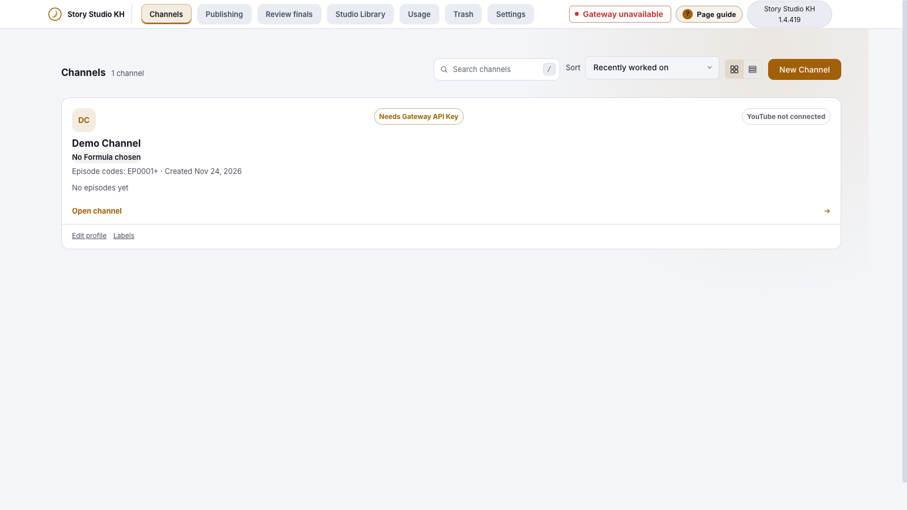
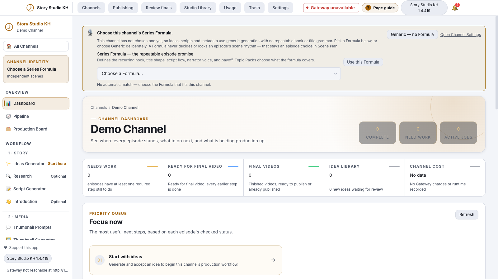
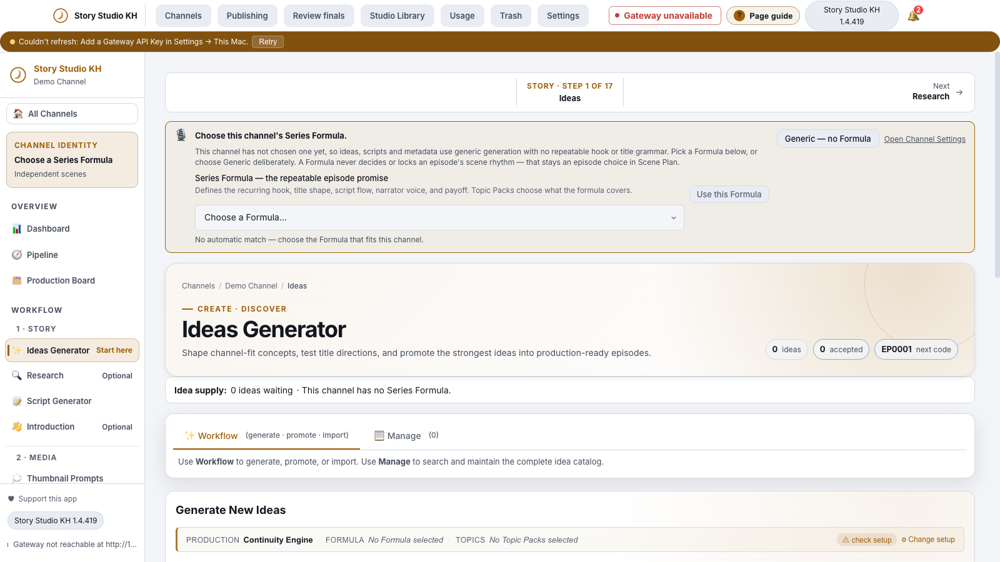

# Story Studio KH

Personal-use desktop app for producing story episodes (script + images +
audio + video assembly + YouTube upload). macOS-only, arm64-only, ad-hoc
signed (no Apple Developer ID).

## What it looks like

The channels screen — one card per channel, with what each one still needs.



A channel's dashboard — where every episode stands and what to do next.



The Ideas Generator — step 1 of the 17-step story-to-upload flow.

[](docs/screenshots/story-ideas-light.png)

## Installing on macOS

Drag `Story Studio KH.app` from the mounted DMG into `/Applications`.
On first launch macOS will block it with one of:

- **"Story Studio KH is damaged and can't be opened"**
- **"The application Story Studio KH can't be opened"**
- **"… cannot be opened because the developer cannot be verified"**

All three come from the same root cause: the app is ad-hoc signed (no paid
Apple Developer ID + notarization), so Gatekeeper rejects it the first
time the OS sees it. There's nothing actually wrong with the build.

Open Terminal and run once after installing:

```sh
xattr -cr "/Applications/Story Studio KH.app"
```

That clears the OS-applied launch-policy flags (`com.apple.quarantine`,
`com.apple.provenance`) on the bundle. Re-launch the app — it goes
straight through Gatekeeper from then on. Reinstall not needed.

(Alternative for "developer cannot be verified" only: right-click the app
in Finder → **Open** → click **Open** in the dialog. On Sonoma+ this
button is sometimes greyed out for ad-hoc apps; the Terminal command
above always works.)

## Project docs

- [`New-computer handoff — 2026-09-20`](docs/handoffs/2026-09-20-new-computer.md) — recovery branch, verified baseline, bug backlog, data migration, and skills to restore.
- [`CHANGELOG.md`](CHANGELOG.md) — what shipped in each release.
- [`docs/`](docs/) — current architecture, operations, planning, and in-flight refactors. Start at [`docs/README.md`](docs/README.md) for the map.
